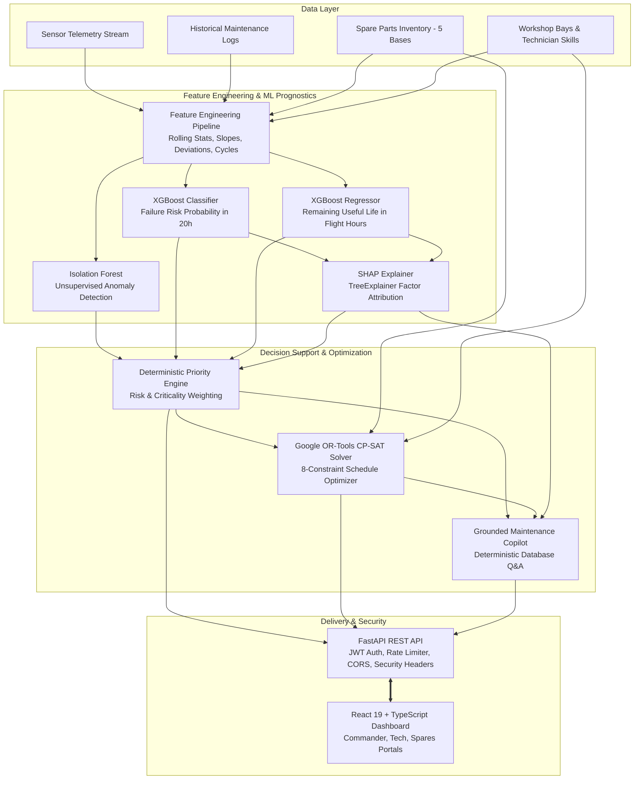

# 🛩️ Jatayu AI — Predictive Maintenance & Fleet Availability Platform

[](https://www.sih.gov.in/)
[](https://www.sih.gov.in/)
[](https://www.sih.gov.in/)
[](https://github.com/revanthgrr/sih_PS-2)
[](https://www.python.org/)
[](https://fastapi.tiangolo.com/)
[](https://react.dev/)
[](https://www.typescriptlang.org/)
[](tests/backend/test_api.py)

---

## 📑 Table of Contents
- [Project Overview](#project-overview)
- [Problem Statement](#problem-statement)
- [Proposed Solution](#proposed-solution)
- [Key Features](#key-features)
- [System Architecture](#system-architecture)
- [Technology Stack](#technology-stack)
- [Project Structure](#project-structure)
- [Prerequisites](#prerequisites)
- [Quick Start](#quick-start)
- [Environment Configuration](#environment-configuration)
- [API Documentation](#api-documentation)
- [Testing](#testing)
- [Troubleshooting](#troubleshooting)
- [Limitations and Future Improvements](#limitations-and-future-improvements)
- [Team and License](#team-and-license)

---

## Project Overview

**Jatayu AI** is an intelligent aerospace prognostics and fleet readiness decision-support platform developed by **Team Track Force** for **Smart India Hackathon 2026**.

The platform is engineered to transition aerospace fleet operations from reactive and schedule-rigid maintenance to predictive, condition-based, and constraint-optimized fleet management. By synthesizing multi-channel sensor telemetry, historical servicing logs, depot spare part inventories, and workshop hangar constraints, Jatayu AI maximizes operational sortie availability while proactively mitigating unscheduled groundings.

### Official SIH Project Details
| Field | Value |
|---|---|
| **Project Title** | Jatayu AI — Predictive Maintenance & Fleet Availability |
| **Problem Statement ID** | SIH26249 |
| **Theme** | Transportation & Logistics |
| **Category** | Software |
| **Team Name** | Track Force |
| **Hackathon** | Smart India Hackathon 2026 |


> [!NOTE]
> **Data Provenance & Safety Notice:**  
> The prototype strictly operates on synthetic and public aerospace degradation benchmarks (structured after NASA C-MAPSS degradation trajectories). Real operational military aircraft data is **not** used. The platform focuses exclusively on asset health prognostics, maintenance scheduling, and supply chain logistics; no tactical, offensive, or combat targeting systems are implemented.

---

## Problem Statement

Defense and commercial aviation fleet managers face reduced operational aircraft availability caused by fragmented data silos and unscheduled technical failures:

1. **Siloed Operational Data:** Sensor telemetry, defect logs, component flight cycle records, spare part depot stocks, and maintenance bay schedules are stored in isolated databases without continuous correlation.
2. **Reactive & Premature Maintenance:** Traditional maintenance relies either on reactive breakdown servicing (causing sudden Aircraft On Ground — AOG events) or fixed flight-hour intervals that replace healthy parts prematurely, inflating operating costs.
3. **Logistics & Skill Bottlenecks:** Scheduled maintenance often stalls due to localized spare part stockouts, uncoordinated technician certifications, and workshop bay oversubscription.
4. **Lack of Explainability:** Black-box AI alerts without root-cause explanations create skepticism among maintenance commanders and aircraft certifying technicians.

$$\textbf{Challenge:} \quad \text{Reactive Maintenance} \implies \text{AOG Disruptions} + \text{Spare Stockouts} + \text{Sub-optimal Sortie Availability}$$

---

## Proposed Solution

**Jatayu AI** provides a unified aerospace decision-support pipeline that operationalizes the full predictive maintenance lifecycle:

$$\textbf{Detect} \longrightarrow \textbf{Predict} \longrightarrow \textbf{Explain} \longrightarrow \textbf{Plan} \longrightarrow \textbf{Optimize} \longrightarrow \textbf{Maximize Availability}$$

### Core Solution Pillars

- **Unsupervised Anomaly Isolation:** An `Isolation Forest` model monitors multidimensional sensor streams (vibration, turbine temperature, oil pressure, hydraulic pressure, electrical voltage) to isolate telemetry drift and emerging degradation without requiring historical labeled failure records.
- **Supervised Failure Risk Classification:** An `XGBoost Classifier` predicts the probability of a critical maintenance event within a 20-hour operational forecast window, categorizing assets into `LOW`, `MEDIUM`, `HIGH`, and `CRITICAL` risk tiers.
- **Remaining Useful Life (RUL) Regression:** An `XGBoost Regressor` estimates the remaining flight hours before component failure, providing 90% confidence bounds (`rul_lower_bound` to `rul_upper_bound`).
- **Explainable AI (SHAP):** Integrated `shap.TreeExplainer` decomposes predictions into local feature contributions, answering **"Why was this risk flagged?"** with transparent factor rankings (e.g., turbine temperature divergence, hydraulic ripple).
- **Grounded Maintenance Copilot:** A deterministic, natural-language maintenance assistant answering queries grounded directly in real-time telemetry, database records, and CP-SAT schedule allocations without requiring external commercial LLM API keys.
- **Constraint Optimization (Google OR-Tools CP-SAT):** An integer programming scheduler that resolves technician skill requirements, workshop hangar bay capacities, RUL deadlines, and spare parts lead times to minimize downtime and elevate fleet availability.

---

## Key Features

The repository contains a fully working, production-audited implementation with the following verified features:

### 1. Role-Based Department Portals & Access Control
- **Air Commander Dashboard (`/app/commander`):** High-level fleet sortie availability KPIs, airframe readiness distribution, critical asset triage, and mission capability indicators.
- **Spares & Logistics Portal (`/app/spares-portal`):** Multi-base warehouse inventory tracking (5 airbases), stockout alerts, lead-time tracking, and spare part reservation endpoints.
- **Technician Maintenance Workspace (`/app/technicians`):** Personalized work-order queues, task execution status tracking (`QUEUED`, `IN_PROGRESS`, `COMPLETED`), and skill qualification verification.
- **Core Operations Center (`/app/overview`, `/app/fleet`, `/app/aircraft`):** Unified fleet-wide command dashboard with quick simulation triggers.

### 2. Interactive 2D Aircraft Digital Twin (`/app/aircraft`)
- Interactive vector schematic with 5 clickable subsystem hotspots:
  - **Engine Module** (Turbofan core, turbine blades, vibration, RPM, oil pressure)
  - **Hydraulic System** (Main actuator, pumps, pressure seals, fluid flow)
  - **Avionics Bay** (Flight control computer, radar transceiver, processor)
  - **Fuel System** (High-pressure booster pumps, fuel metering valves)
  - **Electrical System** (Primary AC starter generator, battery pack, bus voltage)
- Real-time time-series telemetry charts showing temperature, vibration, hydraulic pressure, and operating hours.

### 3. Machine Learning Prognostics Center (`/app/predictions`)
- On-demand multi-model inference per aircraft and subsystem component.
- Real-time display of Anomaly Severity, Failure Probability (%), Predicted RUL (hours), and SHAP attribution factor breakdowns.

### 4. Constraint-Optimized Maintenance Scheduler (`/app/schedule`, `/app/maintenance`)
- Visual Maintenance Timetable with Gantt-style slot allocations.
- Google OR-Tools CP-SAT engine that resolves conflicts across technician shifts, workshop bay capacities, and part delivery timelines.
- Quantifies baseline downtime versus optimized downtime hours and projected fleet availability gains.

### 5. Multi-Base Logistics & Shortage Routing (`/app/spares`)
- Inventory tracking across 5 strategic locations:
  - *AFS Ambala (Haryana)*
  - *AFS Hindon (Ghaziabad)*
  - *4 BRD Kanpur (Uttar Pradesh)*
  - *INS Hansa (Goa)*
  - *AFS Pune (Maharashtra)*
- Automatic stockout warnings and inter-depot transfer recommendations when stock drops below safety thresholds.

### 6. Interactive Prognostic Simulation Lab (`/app/simulation`)
- 5 operational simulation scenarios:
  1. *Nominal Fleet Operations*
  2. *Progressive Sensor Degradation (Turbofan Temperature Drift)*
  3. *Critical Spare Part Shortage (Hydraulic Pump stockout)*
  4. *Hangar Bay & Technician Bottleneck*
  5. *Fleet Readiness Recovery Pipeline*
- Live step-by-step telemetry degradation cycle controls (`Step`, `Start`, `Pause`, `Reset`).

### 7. Grounded Maintenance Copilot (`/api/copilot/query`)
- Context-aware natural-language assistant grounded strictly in SQLite database facts, active predictions, and CP-SAT schedule allocations.
- No external LLM API dependency; runs 100% locally with zero latency or subscription costs.

### 8. System Telemetry Alerts & Triage (`/app/alerts`)
- Multi-severity alert feed (`CRITICAL`, `HIGH`, `MEDIUM`, `INFO`) with one-click acknowledgement tracking.

---

## System Architecture

The following diagram illustrates the end-to-end data flow from aircraft telemetry ingestion through machine learning prognostics, constraint scheduling, and presentation:



### Data Flow Overview
1. **Telemetry Ingestion:** Sensor telemetry (temperature, vibration, pressure, voltage, RPM, fuel flow) is collected and normalized alongside component operating hours and maintenance logs.
2. **Feature Engineering:** Features are generated including 5-step rolling averages, rates of change, degradation slopes, and cumulative cycle ratios.
3. **ML Inference:** The feature vector is evaluated concurrently by Isolation Forest (anomaly detection), XGBoost Classifier (failure probability), and XGBoost Regressor (RUL).
4. **Explainability & Attribution:** The SHAP explainer attributes feature impact scores to identify the primary drivers of degradation.
5. **Constraint Optimization:** The CP-SAT solver ingests pending maintenance tasks, technician skill rosters, workshop bay capacities, and spare part lead times, generating a conflict-free maintenance timetable.
6. **API & Interface:** Secured FastAPI endpoints deliver data to role-tailored React 19 dashboards with sub-second response times.

---

## Technology Stack

The stack is composed of open-source technologies based strictly on repository dependencies:

| Layer | Technology | Version | Purpose in Project |
|---|---|---|---|
| **Backend Framework** | FastAPI | `>=0.110.0` | Asynchronous REST API routing, Pydantic validation, and dependency injection |
| **ASGI Server** | Uvicorn | `>=0.28.0` | High-concurrency production ASGI web server |
| **Validation** | Pydantic v2 | `>=2.6.0` | Strict data validation schemas for requests and responses |
| **Database ORM** | SQLAlchemy | `>=2.0.0` | Object Relational Mapping for fleet, sensor, spare, and task tables |
| **Database** | SQLite / PostgreSQL | `3.x` / `15+` | SQLite default for instant zero-config dev; PostgreSQL-ready via `DATABASE_URL` |
| **Machine Learning** | Scikit-Learn | `>=1.4.0` | Isolation Forest unsupervised anomaly isolation and evaluation metrics |
| **Prognostic ML** | XGBoost | `>=2.0.0` | Gradient-boosted trees for failure risk classification and RUL regression |
| **Explainable AI** | SHAP | `>=0.44.0` | Shapley value factor decomposition for local prediction explainability |
| **Optimization** | Google OR-Tools | `>=9.9.0` | CP-SAT solver for multi-resource constraint maintenance scheduling |
| **Data Processing** | Pandas & NumPy | `>=2.2.0` / `>=1.26.0` | Telemetry manipulation, rolling window statistics, and feature engineering |
| **Security & Auth** | python-jose & passlib | `>=3.3.0` / `>=1.7.4` | JWT Bearer token generation, bcrypt constant-time password hashing |
| **HTTP Client** | HTTPX | `>=0.27.0` | Fast HTTP client used for backend test client execution |
| **Frontend Framework** | React | `^19.2.8` | Component-based interactive user interface |
| **Language** | TypeScript | `~6.0.2` | Static type safety across frontend state, props, and API schemas |
| **Build Tool** | Vite | `^8.3.0` | Ultra-fast frontend bundling and hot-module replacement |
| **Styling** | Tailwind CSS v4 | `^4.3.3` | Utility-first responsive design, dark mode, and UI styling |
| **Routing** | React Router DOM | `^7.18.4` | Client-side routing with role-guarded department routes |
| **Data Visualization** | Recharts | `^3.10.1` | Time-series telemetry graphs, health distribution charts, trend curves |
| **Icons** | Lucide React | `^1.52.0` | Modern aerospace and UI iconography |

---

## Project Structure

```text
Jatayu/
├── .env.example                     # Environment configuration template
├── README.md                        # Master project documentation
├── backend/
│   ├── requirements.txt             # Python backend dependencies
│   ├── jatayu.db                    # Pre-seeded SQLite database
│   ├── app/
│   │   ├── main.py                  # FastAPI entry point, CORS, security headers, rate limiting
│   │   ├── config.py                # Configuration management and environment validation
│   │   ├── auth.py                  # JWT creation, bcrypt verification, role dependencies
│   │   ├── api/                     # REST API route handlers
│   │   │   ├── auth_router.py       # Authentication (/api/auth/login)
│   │   │   ├── health.py            # Public health check (/api/health)
│   │   │   ├── dashboard.py         # Fleet KPIs and availability trend
│   │   │   ├── fleet.py             # Fleet directory and status filters
│   │   │   ├── aircraft.py          # Airframe digital twin and telemetry streams
│   │   │   ├── predictions.py       # ML inference and diagnostics log
│   │   │   ├── maintenance.py       # Work orders, recommendations, and scheduler
│   │   │   ├── spares.py            # Spare parts inventory, shortages, and reservations
│   │   │   ├── simulation.py        # Scenario execution and step degradation
│   │   │   ├── alerts.py            # Real-time alert triage and acknowledgement
│   │   │   ├── models_perf.py       # ML model evaluation metrics
│   │   │   └── copilot.py           # Grounded Maintenance Copilot Q&A
│   │   ├── db/                      # Database definitions
│   │   │   ├── base.py              # SQLAlchemy Base
│   │   │   ├── models.py            # 13 relational table schemas
│   │   │   └── session.py           # Database engine and session factory
│   │   ├── ml/                      # Machine learning prognostics pipeline
│   │   │   ├── feature_engineering/ # Rolling averages, slopes, flight cycle metrics
│   │   │   ├── anomaly_detection/   # Isolation Forest wrapper
│   │   │   ├── failure_prediction/  # XGBoost risk classifier
│   │   │   ├── rul_prediction/      # XGBoost RUL regressor
│   │   │   ├── explainability/      # SHAP TreeExplainer integration
│   │   │   ├── model_manager.py     # Singleton runtime model loader
│   │   │   └── training/
│   │   │       └── train_all.py     # Pipeline training script with grouped trajectory split
│   │   ├── services/                # Domain business logic
│   │   │   ├── fleet_service.py     # Fleet KPI computation and health scoring
│   │   │   ├── optimization_service.py # Google OR-Tools CP-SAT scheduler
│   │   │   └── simulation_service.py   # Telemetry degradation engine
│   │   └── middleware/
│   │       └── rate_limiter.py      # In-memory IP/route rate limiting
│   ├── models/                      # Pre-trained ML model artifacts
│   │   ├── anomaly_model.pkl        # Serialized Isolation Forest
│   │   ├── risk_model.pkl           # Serialized XGBoost Classifier
│   │   ├── rul_model.pkl            # Serialized XGBoost Regressor
│   │   └── metrics/                 # Persisted model evaluation JSON files
│   └── scripts/
│       └── seed_data.py             # Database seed script for synthetic fleet data
├── frontend/
│   ├── package.json                 # Node dependencies and scripts
│   ├── vite.config.ts               # Vite build configuration
│   ├── index.html                   # HTML entry point
│   └── src/
│       ├── App.tsx                  # Root router with role guards and title manager
│       ├── main.tsx                 # React application bootstrap
│       ├── context/                 # AuthContext (JWT in-memory state)
│       ├── pages/                   # User interface views
│       │   ├── LandingPage.tsx      # Public landing page
│       │   ├── DepartmentLoginPage.tsx # Department portal login
│       │   ├── LoginPage.tsx        # Standard user login
│       │   ├── OverviewPage.tsx     # Fleet availability command center
│       │   ├── FleetPage.tsx        # Filterable fleet asset directory
│       │   ├── AircraftDetailPage.tsx # 2D Digital Twin with interactive subsystem hotspots
│       │   ├── PredictionsPage.tsx  # ML prognostics and SHAP feature breakdown
│       │   ├── MaintenancePlannerPage.tsx # Maintenance queue & optimizer
│       │   ├── LogisticsPage.tsx    # Multi-base depot spare parts management
│       │   ├── SimulationLabPage.tsx # Interactive scenario degradation lab
│       │   ├── ModelPerformancePage.tsx # Model accuracy and ROC-AUC metrics
│       │   ├── AlertsPage.tsx       # System alert triage
│       │   ├── SettingsPage.tsx     # System architecture and documentation
│       │   ├── NotFoundPage.tsx     # 404 error page
│       │   ├── commander/           # Air Commander specialized view
│       │   ├── spares/              # Logistics & Spares specialized view
│       │   ├── technician/          # Technician specialized workspace
│       │   └── schedule/            # Visual Maintenance Timetable
│       ├── components/              # Modular UI components, layout, and Copilot
│       └── services/                # Axios API client wrapper
└── tests/
    └── backend/
        └── test_api.py              # 17-test end-to-end integration and security suite
```

---

## Prerequisites

Ensure your workstation meets the following runtime prerequisites:

- **Python:** Version `3.11` to `3.14` (verified on Python `3.13.5`)
- **Node.js:** Version `18.x` or higher (verified on Node.js `v24.13.0`)
- **npm:** Version `9.x` or higher (verified on npm `11.6.2`)
- **Operating System:** Windows 10/11, Ubuntu 20.04+, or macOS 12+
- **Git:** Installed and available in your system path

---

## Quick Start

Follow these steps to set up and run the entire platform locally from scratch.

### 1. Clone Repository
```bash
git clone https://github.com/vasuteja09/JATAYU_SIH.git
cd JATAYU_SIH
```

### 2. Configure Environment Variables
Copy the provided `.env.example` file to create your local `.env`:
```bash
# Windows PowerShell:
Copy-Item .env.example .env

# Linux / macOS:
cp .env.example .env
```
*(Default settings work out-of-the-box for local development using SQLite and default ports).*

### 3. Backend Setup
```bash
# Create and activate Python virtual environment
python -m venv venv

# Windows (PowerShell):
.\venv\Scripts\Activate.ps1

# Linux / macOS:
source venv/bin/activate

# Install Python backend dependencies
pip install -r backend/requirements.txt

# Initialize database & seed synthetic fleet data
python backend/scripts/seed_data.py
```
> The database seed script initializes:
> - 15 Aircraft (`A101` through `A115`)
> - 75 Subsystem Components (Engine, Hydraulic, Avionics, Fuel, Electrical)
> - 375 Time-Series Sensor Readings
> - 59 Historical Maintenance Records
> - 12 Spare Part Types across 5 Airbases
> - 4 Maintenance Workshops & 10 Certified Technicians
> - 7 Active Maintenance Tasks & 4 Initial System Alerts

*(Optional: Retrain ML models. Pre-trained models are already included in `backend/models/`)*:
```bash
python backend/app/ml/training/train_all.py
```

### 4. Frontend Setup
```bash
cd frontend
npm install
cd ..
```

### 5. Run the Application

Start the backend and frontend in separate terminals:

- **Terminal 1 — Backend (FastAPI):**
  ```bash
  cd backend
  python -m uvicorn app.main:app --host 0.0.0.0 --port 8000 --reload
  ```
  *Backend will be running at [http://localhost:8000](http://localhost:8000) (Interactive Swagger Docs: [http://localhost:8000/docs](http://localhost:8000/docs))*

- **Terminal 2 — Frontend (Vite + React):**
  ```bash
  cd frontend
  npm run dev
  ```
  *Frontend will be running at [http://localhost:5173](http://localhost:5173)*

### 6. Verified Demo Credentials
The application includes pre-configured, role-based accounts for evaluation:

| Portal Role | Target Route | Username | Password | Access Scope |
|---|---|---|---|---|
| **Air Commander** | `/login/commander` | `commander` | `commander123` | High-level fleet sortie availability, operational readiness KPIs, critical asset status |
| **Spares & Logistics** | `/login/spares` | `spares` | `spares123` | Multi-depot parts inventory, stockout alerts, lead times, part reservations |
| **Maintenance Technician** | `/login/technician` | `technician` | `tech123` | Assigned work orders, skill qualification matching, task status updates |
| **Full Demo / Admin** | `/login` | `demo` | `demo` | Unrestricted access across all operational modules and simulation controls |

---

## Environment Configuration

Configuration is managed via `.env` in the project root. The table below lists all supported configuration variables based on `.env.example`:

| Environment Variable | Default Value | Description |
|---|---|---|
| `DATABASE_URL` | `sqlite:///backend/jatayu.db` | SQLAlchemy connection string. Defaults to local SQLite; use PostgreSQL URI for production |
| `API_HOST` | `0.0.0.0` | Network interface to bind the FastAPI backend server |
| `API_PORT` | `8000` | Port for the FastAPI backend server |
| `PRODUCTION_MODE` | `false` | When `true`, disables `/docs` and `/redoc`, tightens CORS, and hides debug errors |
| `CORS_ALLOWED_ORIGINS` | *(empty in dev)* | Comma-separated list of allowed frontend origins in production mode |
| `JWT_SECRET` | *(dev fallback)* | Secret key for signing JWT tokens. Required in production (`python -c "import secrets; print(secrets.token_hex(32))"`) |
| `JWT_ALGORITHM` | `HS256` | Cryptographic algorithm for JWT signatures |
| `JWT_EXPIRE_HOURS` | `8` | Expiry duration for user session tokens |
| `DEMO_USERNAME` / `DEMO_PASSWORD` | `demo` / `demo` | Credentials for the master demo account |
| `COMMANDER_USERNAME` / `COMMANDER_PASSWORD` | `commander` / `commander123` | Credentials for the Air Commander role |
| `SPARES_USERNAME` / `SPARES_PASSWORD` | `spares` / `spares123` | Credentials for the Spares & Logistics role |
| `TECHNICIAN_USERNAME` / `TECHNICIAN_PASSWORD` | `technician` / `tech123` | Credentials for the Maintenance Technician role |
| `MODEL_DIR` | `models` | Directory path for serialized ML model artifacts (`.pkl`) |
| `RANDOM_SEED` | `42` | Random seed for reproducible synthetic data generation and model training |
| `PREDICTION_HORIZON_HOURS` | `20` | Forecast window (in operating hours) for failure risk classification |
| `RISK_THRESHOLD_LOW` | `0.25` | Failure probability threshold for `LOW` risk tier |
| `RISK_THRESHOLD_MEDIUM` | `0.55` | Failure probability threshold for `MEDIUM` risk tier |
| `RISK_THRESHOLD_HIGH` | `0.80` | Failure probability threshold for `HIGH` / `CRITICAL` risk tier |
| `LOG_LEVEL` | `INFO` | Backend logging level (`DEBUG`, `INFO`, `WARNING`, `ERROR`) |
| `VITE_API_BASE_URL` | `http://localhost:8000` | Base URL used by the Vite frontend to reach the backend REST API |

---

## API Documentation

When the backend is running in development mode (`PRODUCTION_MODE=false`), interactive documentation is automatically available:
- **Interactive Swagger UI:** [http://localhost:8000/docs](http://localhost:8000/docs)
- **ReDoc Documentation:** [http://localhost:8000/redoc](http://localhost:8000/redoc)
- **OpenAPI Schema Specification:** [http://localhost:8000/openapi.json](http://localhost:8000/openapi.json)

### Verified REST API Endpoints

#### Public Endpoints (No Authentication Required)
| Method | Endpoint | Purpose | Rate Limit |
|---|---|---|---|
| `GET` | `/` | Root service metadata and data provenance notice | None |
| `GET` | `/api/health` | Service health and liveness probe | 100/min |
| `POST` | `/api/auth/login` | Authenticate user credentials and issue signed JWT Bearer token | 20/min |

#### Protected Endpoints (Bearer JWT Header Required: `Authorization: Bearer <token>`)
| Method | Endpoint | Purpose |
|---|---|---|
| `GET` | `/api/dashboard/summary` | Fleet KPIs, operational availability trends, and risk distribution |
| `GET` | `/api/fleet` | Filterable list of all aircraft (supports `status`, `type`, `search`) |
| `GET` | `/api/fleet/summary` | Fleet-wide counts aggregated by operational status |
| `GET` | `/api/fleet/availability-trend` | 30-day historical availability percentage |
| `GET` | `/api/aircraft` | Overview list of all airframes |
| `GET` | `/api/aircraft/{aircraft_id}` | Detailed airframe digital twin, components, and latest prediction |
| `GET` | `/api/aircraft/{aircraft_id}/sensors` | Time-series telemetry readings for charts (`limit` parameter up to 200) |
| `GET` | `/api/aircraft/{aircraft_id}/maintenance` | Historical maintenance work orders for specified aircraft |
| `GET` | `/api/aircraft/{aircraft_id}/components` | Subsystem component health scores and accumulated flight cycles |
| `POST` | `/api/predict/{aircraft_id}` | Execute multi-model ML inference (Anomaly + Risk + RUL + SHAP) |
| `GET` | `/api/predictions` | Prognostic diagnostic log across all fleet assets |
| `GET` | `/api/maintenance/queue` | Pending maintenance tasks sorted by urgency and priority |
| `GET` | `/api/maintenance/recommendations` | Prescriptive maintenance actions for at-risk airframes |
| `GET` | `/api/maintenance/schedule` | Visual maintenance timetable allocations |
| `POST` | `/api/maintenance/optimize` | Execute Google OR-Tools CP-SAT scheduler optimization |
| `PATCH` | `/api/maintenance/tasks/{task_id}/status` | Update maintenance task status (`QUEUED`, `IN_PROGRESS`, `COMPLETED`) |
| `POST` | `/api/maintenance/request` | Submit an unscheduled inspection or servicing work order |
| `GET` | `/api/spares` | Depot spare parts inventory across all 5 bases |
| `GET` | `/api/spares/shortages` | Spare part SKUs falling below minimum safe stock levels |
| `POST` | `/api/spares/reserve` | Reserve spare part SKU for a scheduled maintenance task |
| `PATCH` | `/api/spares/{part_id}/stock` | Adjust warehouse inventory quantity for a spare part SKU |
| `GET` | `/api/simulation/state` | Current telemetry scenario injection state |
| `POST` | `/api/simulation/start` | Start simulation scenario |
| `POST` | `/api/simulation/step` | Advance simulation by 1 telemetry degradation cycle |
| `POST` | `/api/simulation/pause` | Pause active telemetry simulation |
| `POST` | `/api/simulation/reset` | Reset simulation state back to nominal fleet values |
| `GET` | `/api/alerts` | Active system telemetry and threshold alerts |
| `PATCH` | `/api/alerts/{alert_id}/acknowledge` | Acknowledge active alert by ID |
| `GET` | `/api/models/metrics` | Accuracy, ROC-AUC, MAE, and RMSE metrics for trained models |
| `GET` | `/api/models/features` | Feature importance ranking and column definitions |
| `POST` | `/api/copilot/query` | Grounded Maintenance Copilot natural language Q&A |

---

## Testing

The repository contains an end-to-end integration and security test suite using FastAPI's `TestClient`.

### Running Backend Integration Tests
From the project root:
```bash
python tests/backend/test_api.py
```

### Verified Test Suite Results (17/17 Passed)
```text
PASS: test_health                     - Public health probe
PASS: test_auth_required              - Unauthenticated requests rejected with 401
PASS: test_invalid_login              - Invalid credentials rejected with 401
PASS: test_valid_login                - Valid credentials return signed JWT Bearer token
PASS: test_security_headers           - Security headers (nosniff, DENY, strict-origin) verified
PASS: test_invalid_aircraft_id        - Path traversal & malformed IDs rejected (400/404)
PASS: test_sensor_limit_bounds        - Query limit > 200 returns 422 Unprocessable Entity
PASS: test_status_filter_validation   - Query injection attempts rejected with 400 Bad Request
PASS: test_dashboard_summary          - Fleet KPIs and availability trend computed accurately
PASS: test_fleet_endpoints            - Fleet directory and summary counts verified
PASS: test_aircraft_detail_and_sensors- Digital twin and telemetry time-series verified
PASS: test_prediction_endpoint        - Multi-model ML pipeline inference (Anomaly+Risk+RUL+SHAP)
PASS: test_spares_and_shortages       - Depot inventory and critical shortages verified
PASS: test_maintenance_optimizer      - Google OR-Tools CP-SAT scheduler optimization verified
PASS: test_simulation_cycle           - Prognostic scenario step and reset cycle verified
PASS: test_alerts                     - Alert dispatch and lifecycle verified
PASS: test_model_metrics              - Model validation metrics verified

Result: 17/17 tests passed (100% success rate).
```

### Frontend Type-Checking and Linting
```bash
cd frontend
npm run build
```
This executes TypeScript type checking (`tsc -b`) and Vite production bundling to verify frontend code integrity.

---

## Troubleshooting

| Issue | Likely Cause | Solution |
|---|---|---|
| `ModuleNotFoundError: No module named 'app'` | Running python without `backend` on `PYTHONPATH` | Run scripts from the project root using documented paths (e.g. `python backend/scripts/seed_data.py`) or activate your virtual environment. |
| `ERROR: No sensor readings found in database` | SQLite database has not been initialized | Run the seed script: `python backend/scripts/seed_data.py`. |
| `CORS Error / Network Error in Browser` | Frontend unable to contact backend | Ensure backend is running on `http://localhost:8000`. Confirm `VITE_API_BASE_URL` in `.env` is set to `http://localhost:8000`. |
| `Port 8000 or 5173 already in use` | Another process is occupying the required port | Change `API_PORT` in `.env` for backend, or launch frontend with `npm run dev -- --port 5174`. |
| `Missing ML Model Files (.pkl)` | Models deleted or not yet generated | Pre-trained models are included in `backend/models/`. You can regenerate them at any time by running `python backend/app/ml/training/train_all.py`. |
| `401 Unauthorized on protected routes` | Missing or expired JWT token | Log in through the login page (`/login`) or re-authenticate using the credentials in the [Verified Demo Credentials](#6-verified-demo-credentials) table. |

---

## Limitations and Future Improvements

To ensure transparency and integrity, existing capabilities are clearly distinguished from planned extensions:

### Existing Capabilities (Implemented & Verified)
- ✅ **Synthetic Aerospace Data Ingestion:** Generates realistic 5-subsystem telemetry based on NASA C-MAPSS degradation trajectories.
- ✅ **Multi-Model ML Pipeline:** Unsupervised Isolation Forest, Supervised XGBoost Classifier, and Supervised XGBoost Regressor.
- ✅ **Explainable AI:** Local feature attribution using `shap.TreeExplainer` for every high-risk alert.
- ✅ **Constraint Optimization:** Google OR-Tools CP-SAT engine scheduling work orders across technician skills, bay limits, and deadlines.
- ✅ **Grounded Copilot:** Fully local natural-language assistant answering queries grounded in real database state without external API fees.
- ✅ **Department Portals:** Role-guarded workspaces for Commanders, Spares Managers, and Technicians with JWT security.
- ✅ **Simulation Lab:** 5 interactive scenarios with step-by-step telemetry degradation.

### Known Limitations & Simulated Scope
- ⚠️ **Synthetic Data Scope:** The platform operates exclusively on synthetic and public benchmark data. Classified operational defense data is **not** integrated.
- ⚠️ **Decision Support Only:** Recommendations generated by the ML models and CP-SAT optimizer are advisory decision-support outputs; certified aircraft maintenance engineers must inspect and sign off on all physical airframe releases.
- ⚠️ **Single-Node In-Memory Rate Limiting:** The current rate limiter uses an in-memory dictionary; distributed deployments will require a Redis-backed token bucket.

### Future Improvements (Planned Roadmap)
- 🚀 **MIL-STD-1553 & ARINC 429 Bus Telemetry Ingestion:** Support direct serial and avionics bus streaming protocols.
- 🚀 **Defense Logistics ERP Integration:** Bidirectional synchronization with defense inventory management systems (e.g. SAP/COTS defense modules).
- 🚀 **Distributed PostgreSQL & Redis Caching:** Multi-node database clustering with Redis Pub/Sub for high-throughput live telemetry.
- 🚀 **Automated Work-Order PDF Dispatch:** One-click generation of military-standard inspection work cards with digital signatures.
- 🚀 **Offline Hangar Companion:** Progressive Web App (PWA) offline mode for flight-line technicians operating in disconnected hangars.

---

## Team and License

### Team Information
- **Team Name:** Track Force
- **Hackathon:** Smart India Hackathon 2026
- **Problem Statement ID:** SIH26249
- **Project Title:** Jatayu AI — Predictive Maintenance & Fleet Availability
- **Theme:** Transportation & Logistics
- **Category:** Software

### License
*No public open-source license file is currently included in this repository. All rights are reserved by **Team Track Force** for Smart India Hackathon 2026 submission and evaluation.*
